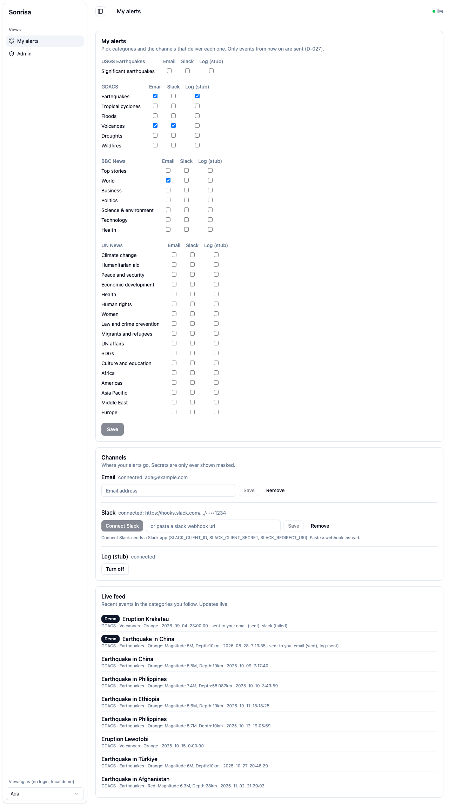
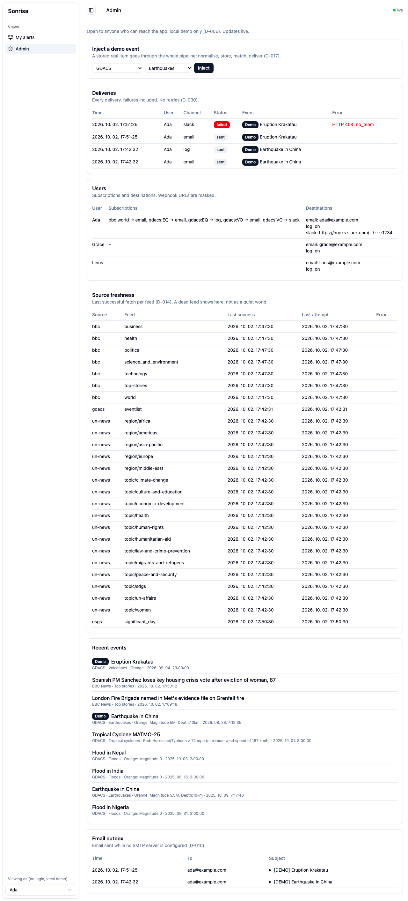
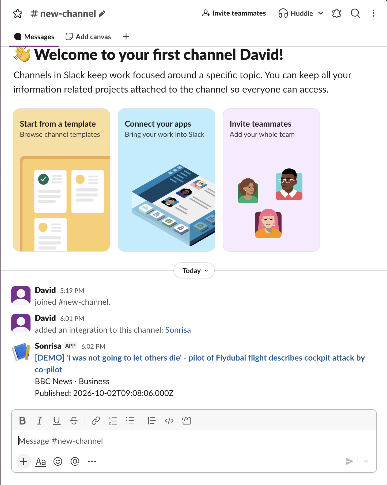

# Sonrisa

Alerts for important world events, by email, Slack and a stub "log" channel. Users pick categories (earthquakes, cyclones, BBC sections, UN topics…) and the channels that should deliver each one. New events from four free public sources are delivered once per user and channel. An admin view shows users, events, every delivery including failures, source freshness and the email outbox, and can inject a demo event.

This is a response to a take-home task: turn a vague brief into a working system using AI agents. The task says the **process is evaluated, not the solution**, so most of this repository is [process/](#process-how-it-was-built): the plan, the decisions, what the AI got wrong and every prompt.

| User view | Admin view | Real Slack delivery |
| --- | --- | --- |
| [](process/08-screenshots/m8-user-live.png) | [](process/08-screenshots/m8-admin-view.png) | [](process/08-screenshots/m8-slack-real-message.png) |

> **Local demo only.** There is no login. Anyone who can reach the app can see every user's data in the admin view. Do not expose it on a network ([D-006](process/05-decisions/decision-log.md#d-006-two-views-no-authentication)).
>
> **Not an emergency warning service.** Alerts come from free third-party feeds and can be late, incomplete or missing. For your safety, follow your official local authorities.

## Quick start

Needs **Node 22.12+** ([.nvmrc](.nvmrc); with nvm: `nvm use`). No keys, no Docker, no `.env`.

```sh
npm install
npm run dev        # web: http://localhost:5173   API: :3001
```

Open http://localhost:5173. Tests: `npm test`.

- On an older Node, `npm install` stops with `EBADENGINE`, and the server says which version it needs ([D-034](process/05-decisions/decision-log.md#d-034-enforce-node-22-at-install-and-start)).
- `npm install` runs a no-op `node-gyp` step for `better-sqlite3` (a prebuilt binary is bundled), which needs Python 3 and `make`. On macOS, the Xcode Command Line Tools provide them ([R-016](process/06-ai-review/ai-review-log.md#r-016-better-sqlite3-13-still-runs-node-gyp)).
- The database is `app/server/data/sonrisa.db` (git-ignored). Delete it to start fresh.

## Try it (5 minutes)

1. **Pick a user.** The picker is at the bottom left (Ada, Grace or Linus). Each one already has an email and a log destination.
2. **Pick categories.** In **My alerts**, tick a category under a channel, e.g. *GDACS · Earthquakes* → *Email* and *Log (stub)*, then **Save**. Only events from now on are delivered, not the backlog ([D-027](process/05-decisions/decision-log.md#d-027-first-poll-only-marks-items-as-seen-subscriptions-apply-forward-only)).
3. **Inject a demo event.** Go to **Admin**, then **Inject a demo event**, choose *GDACS* / *Earthquakes* and press **Inject**. A real stored item goes through the same pipeline as a polled one: store, match, deliver ([D-017](process/05-decisions/decision-log.md#d-017-accepted-ai-recommendations)).
4. **See the result.**
   - The **Email outbox** in Admin shows the email. Without SMTP, email goes to this outbox.
   - **Deliveries** shows one row per channel, with any failure and its error.
   - The terminal prints a `[log channel]` line.
   - Back in **My alerts**, the live feed shows the event. Both views update live, with no reload.

Real events arrive on their own. Polling runs every 2 min (USGS), 5 min (BBC), 10 min (GDACS) and 15 min (UN News). The first fetch of each feed is a baseline and notifies nobody.

## Slack (optional)

Both ways end in a stored `hooks.slack.com` webhook. Only that host is accepted, on save and again before every send ([D-022](process/05-decisions/decision-log.md#d-022-pasted-webhooks-only-to-hooksslackcom)).

- **Paste a webhook.** Under **Channels**, paste an incoming-webhook URL from your own Slack app and press **Save**. It is shown masked from then on.
- **Connect Slack button** (needs your own Slack app):
  1. Create a Slack app, activate **Incoming Webhooks**, and add `https://localhost:5173/api/slack/oauth/callback` as a redirect URL under **OAuth & Permissions**.
  2. In a repo-root `.env` (copy [.env.example](.env.example)), set `SLACK_CLIENT_ID`, `SLACK_CLIENT_SECRET` and `SLACK_REDIRECT_URI=https://localhost:5173/api/slack/oauth/callback`.
  3. Slack requires HTTPS, so run `HTTPS=1 npm run dev`, open https://localhost:5173 and accept the self-signed certificate once.

  Without these settings the button is shown disabled, with a note.

Only the repo-root `.env` is read. `.env.local` and `.env.development` are not supported. SMTP settings in the same file switch email from the outbox to a real server.

## Architecture

```
 USGS · GDACS · BBC · UN News          (polled, per-source interval)
            │  parse + normalise (one module per source)
            ▼
 ingest ── dedup on any external ID ──► SQLite (events, categories, feeds)
            │  new events only (first fetch of a feed = baseline)
            ▼
 match: subscriptions × destinations ──► deliveries (UNIQUE event+user+channel)
            │
            ▼
 dispatch ──► email (SMTP or dev outbox) · slack (webhook) · log (stub)
            │
            ▼
 SSE ──► React UI (user view, admin view)
```

- **Server:** `app/server`, with Node, TypeScript, Express and SQLite (better-sqlite3). One process runs the API and the poller.
- **Web:** `app/web`, with React, Vite and shadcn/ui. Vite proxies `/api`.
- **A channel is one module plus one line** in [channels/index.ts](app/server/src/channels/index.ts) ([D-001](process/05-decisions/decision-log.md#d-001-channels-are-delivery-mechanisms-one-module-per-channel), [D-029](process/05-decisions/decision-log.md#d-029-channels-are-registered-with-one-line-in-the-channels-folder)). The core never names a channel; the UI renders each channel's form from its declared fields. The `log` stub was added this way to prove it.
- **Sources are modules too**, and every field they read was checked against a stored real response in [raw-responses/](process/03-research/raw-responses/).
- **Two kinds of dedup:** events by source and any external ID, and deliveries by a unique key. No retries ([D-030](process/05-decisions/decision-log.md#d-030-no-delivery-retries)). Failures are stored and shown.

Full design: [design.md](process/04-design/design.md).

## Process: how it was built

Start with these:

- [Brief](process/01-brief/brief.md): the task as received
- [Plan](process/02-plan/plan.md), with milestones M1–M10 and what "done" meant for each, plus [assumptions](process/02-plan/assumptions.md) and the deferred "Later" list
- [Decision log](process/05-decisions/decision-log.md): every decision, the options considered, and who made it
- [AI review log](process/06-ai-review/ai-review-log.md): what the AI produced, how it was checked, and what was corrected or rejected. Two independent code reviews are in R-033 and R-035
- [Prompts](process/07-prompts/session-log.md): every prompt, with [verbatim transcripts](process/07-prompts/transcripts/) and full exported sessions

Also: [research](process/03-research/) (source checks with raw API responses), [design](process/04-design/design.md), [screenshots](process/08-screenshots/), and the rules given to the AI, [CLAUDE.md](CLAUDE.md).

## Known limitations

- **UX and visual design were deliberately out of scope.** The UI is a shadcn admin template ([satnaing/shadcn-admin](https://github.com/satnaing/shadcn-admin), MIT; see [notices](app/web/THIRD-PARTY-NOTICES.md)), just enough to try every feature.
- **One app, no login.** The next step would be to split it into two apps, a user app and an admin app, with the admin app behind a login.
- **Unverified:**
  - **Cancelling on Slack's approval page.** The callback treats any return without a code as "not connected". Slack's exact parameters for this case are undocumented and were not tried for real.
  - **Real SMTP.** It is built from nodemailer's docs and tested with a fake transport only; it has never sent through a real mail server. The dev outbox is the tested path.
  - **`&` in Slack links.** `&`, `<` and `>` in link URLs are escaped as Slack's formatting doc requires, but no link containing `&` was sent to a real workspace.
  - **Pasted webhooks against real Slack.** The real Slack test used the Connect button. The paste path shares its delivery code but was tested only with a local mock receiver ([D-023](process/05-decisions/decision-log.md#d-023-slack-delivery-tested-with-a-mock-receiver-then-once-for-real)).
- **No price alerts.** "Market movements" come from the BBC Business section, not from price feeds ([D-024](process/05-decisions/decision-log.md#d-024-market-movements-via-bbc-business-no-price-feeds)).
- **No GovSlack.** Only `hooks.slack.com` is accepted ([D-026](process/05-decisions/decision-log.md#d-026-govslack-not-supported)).
- **Per-source dedup only.** The same quake reported by USGS and GDACS is two events. More is deferred in the [Later list](process/02-plan/assumptions.md#later-out-of-scope-for-the-24-hour-build): filters within a category, re-notifying revised events, rate limits and retries.
