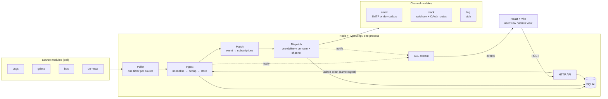

# Design

> **Status: reviewed.** Open points decided in D-027 to D-031. Independent review findings F1–F15 handled as logged in [R-013](../06-ai-review/ai-review-log.md#r-013-independent-review-of-the-m4-design).
> Built on [data-sources.md](../03-research/data-sources.md) and decisions D-001 to D-031. Items marked *unverified* have not been checked against a stored response or an official doc yet, and must be before code is written against them (CLAUDE.md).

## Overview

Sonrisa polls four sources: USGS significant earthquakes, the GDACS default event list, BBC News sections and UN News feeds. It turns each item into one common event and stores it once. It matches the event against user subscriptions (category × channel) and delivers each match exactly once through a channel module: email (SMTP or dev outbox), Slack (webhook), or log (stub). An admin view shows everything and can inject a demo event through the same pipeline. Both views update live over SSE.

Guiding rule: **the smallest thing that meets the decisions.** Each section ends with what was deliberately left out.

## Architecture



- **One Node process** runs the API, the poller and dispatch, and SQLite has a single writer. `npm run dev` starts that process and the Vite dev server (D-009). The plan says "API, worker and web UI". The worker is a module inside the API process, not a separate process.
- **The core** is Poller, Ingest, Match, Dispatch, the API and SSE. It knows only the `Source` and `Channel` interfaces, never a specific source or channel (D-001).

Left out as overkill: a separate worker process, a job queue (Redis, BullMQ), microservices, an ORM-heavy layer. The SQLite driver is still open (Q6, M5).

## Common event format

D-017 lists the fields. One normalised event:

```ts
type NormalisedEvent = {
  sourceId: string;          // 'usgs' | 'gdacs' | 'bbc' | 'un-news'
  externalIds: string[];     // first = primary; all are used for dedup (USGS has several)
  categoryKey: string;       // source-specific, e.g. 'significant', 'TC', 'world', 'topic/health'
  title: string;
  occurredAt: string | null; // ISO 8601 UTC; when it happened (or is forecast to)
  publishedAt: string | null;// ISO 8601 UTC; when the source published it
  location: { text: string | null; lat: number | null; lon: number | null };
  severity: string | null;   // display text only, never used for filtering (D-018)
  link: string;              // http(s) only
  isForecast: boolean;       // occurredAt later than ingest time (GDACS GloFAS floods)
  raw: unknown;              // the original item, kept for the admin view and debugging
};
```

### Mapping per source

These are the real field names, checked against the stored responses ([data-sources.md, field table](../03-research/data-sources.md#where-the-event-fields-really-are)).

| Field | USGS `significant_day.geojson`, per `features[]` | GDACS `geteventlist/SEARCH` (no params), per `features[]` | BBC RSS `<item>` | UN News RSS `<item>` |
| --- | --- | --- | --- | --- |
| externalIds | `id`, plus every entry of `properties.ids` (split `,ci41342111,` on commas, drop empties) | `` `${properties.eventtype}${properties.eventid}` `` (same shape as the RSS `guid`, e.g. `FL1104169`) | `guid` as is (e.g. `https://www.bbc.co.uk/news/articles/c639m98gde00o#0`) | `guid` (permalink) |
| categoryKey | `'significant'` (the feed polled) | `properties.eventtype` (`EQ`, `TC`, `FL`, `VO`, `DR`, `WF`) | the feed polled, e.g. `world` | the feed polled, e.g. `topic/health` |
| title | `properties.title` | `properties.name` | `title` | `title` |
| occurredAt | `properties.time` (epoch ms → ISO) | `properties.fromdate` (no zone; **assumed UTC, unverified**) | – | – |
| publishedAt | `properties.time` | `properties.datemodified` (no zone; **assumed UTC, unverified**) | `pubDate` (RFC 822) | `pubDate`, **date only** (always 12:00:00) |
| location | `properties.place`; `geometry.coordinates[1]`, `[0]` (lat, lon; [2] is depth) | `properties.country`; `geometry` point if `Point`, else null | – | – |
| severity | `` `M${properties.mag} ${properties.magType}` `` | `properties.alertlevel` (+ `properties.severitydata.severitytext`) | – | – |
| link | `properties.url` | `properties.url.report` | `link` with `?at_medium=RSS&at_campaign=rss` stripped | `link` |
| isForecast | false | `fromdate` after ingest time | false | false |

Notes from M3 that shape this:
- **USGS:** use `significant_day`, polled every 2 min. Its stored sample ([significant_day.geojson](../03-research/raw-responses/usgs/significant_day.geojson)) had **no events** that day: `features` is `[]` and the top-level `bbox` key is absent. So the feature fields come from `significant_month`, and code must handle an empty feed without `bbox`. The feed updates every minute, and a one-day window survives restarts. *Unverified:* whether `id` can change between polls. Matching on all of `properties.ids` covers that case.
- **GDACS:** a new `episodeid` means an update to a known event. It is **not** a new event, and re-notifying on revisions is under Later.
- **BBC:** the `#0` suffix on `guid` may change on updates (*unverified*). If it does, an update would look new. Accepted as a known risk; see [Event dedup](#event-dedup).

## Categories: from the sources to the user's list

D-013 says categories are data, not code. In practice:

1. **Each source module declares the categories it offers**, with a label. The values are the ones verified in M3:

   | Source | Category keys → labels |
   | --- | --- |
   | usgs | `significant` → "Significant earthquakes" |
   | gdacs | `EQ` → "Earthquakes", `TC` → "Tropical cyclones", `FL` → "Floods", `VO` → "Volcanoes", `DR` → "Droughts", `WF` → "Wildfires" (GDACS Orange/Red alerts) |
   | bbc | `top-stories` (feed `news/rss.xml`) → "Top stories", `world`, `business`, `politics`, `science_and_environment`, `technology`, `health` (BBC section names) |
   | un-news | the 12 topics and 5 regions verified in M3 (e.g. `topic/health` → "Health", `region/africa` → "Africa") |

2. **At startup the core upserts these into the `categories` table.** The UI reads `GET /api/categories` and renders them grouped by source ("BBC News › World"). No category list exists in UI code.
3. **An unknown value seen in data** (e.g. a GDACS `eventtype` not in the list) still gets stored. Its category is auto-created with the raw code as its label and shows up in the admin view. Nothing is silently dropped.
4. **Overlaps are not merged.** USGS "Significant earthquakes" and GDACS "Earthquakes" are separate choices. Cross-source dedup is under Later, and the README says the same quake can arrive twice.

**Decided (D-031):** the 7 BBC sections above. The BBC has more (uk, education, entertainment_and_arts, regional feeds). Adding one means one line in the BBC module, plus a stored sample per CLAUDE.md.

## Data model (SQLite)

```sql
users        (id INTEGER PK, name TEXT NOT NULL)                     -- seeded demo users (D-015)

sources      (id TEXT PK, name TEXT NOT NULL)

feeds        (source_id TEXT REFERENCES sources, feed_key TEXT,    -- F3/F13: one row per URL polled
              baselined_at TEXT,          -- set on the feed's first successful fetch (D-027); persisted
              last_attempt_at TEXT, last_success_at TEXT, last_error TEXT,   -- freshness (D-014)
              PRIMARY KEY (source_id, feed_key))

categories   (id TEXT PK,               -- `${source_id}:${key}`, e.g. 'gdacs:TC'
              source_id TEXT NOT NULL REFERENCES sources,
              key TEXT NOT NULL, label TEXT NOT NULL,
              declared INTEGER NOT NULL,  -- 0 = auto-created from unknown data
              UNIQUE (source_id, key))

events       (id INTEGER PK, source_id TEXT NOT NULL,
              title TEXT, occurred_at TEXT, published_at TEXT,
              location_text TEXT, lat REAL, lon REAL, severity TEXT, link TEXT,
              is_forecast INTEGER, is_demo INTEGER NOT NULL DEFAULT 0,   -- F11: demo marker for both views
              raw TEXT, ingested_at TEXT NOT NULL,
              notify INTEGER NOT NULL)    -- 0 for baseline items, see below

event_categories (event_id INTEGER REFERENCES events, category_id TEXT REFERENCES categories,
              PRIMARY KEY (event_id, category_id))                   -- D-028: one event, several feeds

event_keys   (source_id TEXT NOT NULL, external_id TEXT NOT NULL,
              event_id INTEGER NOT NULL REFERENCES events,
              PRIMARY KEY (source_id, external_id))                  -- EVENT DEDUP

destinations (user_id INTEGER REFERENCES users, channel TEXT,       -- 'email' | 'slack' | 'log' | ...
              config TEXT NOT NULL,       -- JSON; slack {"webhookUrl"}, email {"address"}, log {} — never returned unmasked
              label TEXT,                 -- e.g. Slack '#channel' from OAuth
              PRIMARY KEY (user_id, channel))

subscriptions(user_id INTEGER REFERENCES users, category_id TEXT REFERENCES categories,
              channel TEXT, created_at TEXT NOT NULL,
              PRIMARY KEY (user_id, category_id, channel))           -- D-013: channels per category

deliveries   (id INTEGER PK, event_id INTEGER REFERENCES events, user_id INTEGER, channel TEXT,
              status TEXT NOT NULL,       -- 'pending' | 'sent' | 'failed'
              error TEXT,                 -- masked error text; no retry flag (D-030, F9)
              created_at TEXT, sent_at TEXT,
              UNIQUE (event_id, user_id, channel))                   -- NOTIFICATION DEDUP (D-005)

-- Owned by channel modules, not the core (F7). Each module creates its own table:
outbox       (id INTEGER PK, delivery_id INTEGER REFERENCES deliveries,      -- email channel: dev outbox (D-010)
              to_address TEXT, subject TEXT, text TEXT, html TEXT, created_at TEXT)

oauth_states (state TEXT PK, user_id INTEGER, created_at TEXT)  -- slack channel: OAuth CSRF, 10 min
```

**Timestamps (F10):** every timestamp column is written by app code as ISO 8601 UTC from one helper (`new Date().toISOString()`, e.g. `2026-10-02T14:00:00.000Z`). SQLite's `datetime('now')` is never used, so string comparison of `ingested_at` and `created_at` is correct.

### Event dedup
- **Rule:** an incoming event is a duplicate if **any** of its `externalIds` already exists in `event_keys` for that source. Then no new event is stored. Any new IDs are added to the known event, and any new category is linked in `event_categories` (D-028), without notifying anyone.
- **Where it's enforced:** the primary key on `event_keys`, inside one transaction: check, insert the event, insert its keys. This also handles a story that appears in several BBC or UN feeds (M3: 131 of 369 UN GUIDs are in more than one feed). The key is source + ID, not feed + ID.
- **Category of a multi-feed story (D-028, F1):** Ingest works on **one whole poll of a source** (all its feeds), not item by item:
  1. fetch every feed; each item comes with the feed it was found in;
  2. normalise each item with that feed's category;
  3. group the poll's events by shared external ID, so the same story from `world` and `top-stories` becomes one event with both categories;
  4. in one transaction, store new events with all their categories and link new categories to known events;
  5. only then run Match for the new events.

  A story seen in two feeds in the same poll therefore reaches subscribers of either feed. A category link added on a **later** poll notifies nobody (D-028).

### Notification dedup
`UNIQUE (event_id, user_id, channel)` on `deliveries`. Dispatch uses `INSERT OR IGNORE`, then sends only the rows it actually inserted. A re-poll, a restart or a double poll can't send twice. (Each inject is a new event, see [Demo inject](#demo-inject-d-006-d-017).)

### First poll and old items
**Decided (D-027).** Without a rule, the first poll of BBC World stores 30 existing stories, and every subscriber gets 30 messages at startup. M3 also showed that BBC section feeds contain old items (a 2025 story in top stories). Proposal:
1. **Baseline, per feed and persisted (F3):** the first successful fetch of **each feed** (each URL polled: one for USGS and GDACS, 7 for BBC, 17 for UN News) stores its items with `notify = 0` and sets `feeds.baselined_at`. Later fetches of that feed store new items with `notify = 1`. Because `baselined_at` is in the database, a restart does not re-baseline. Items published while the app was down are notified on the next poll. A feed that fails on the first poll stays un-baselined until it succeeds, so it can't flood anyone later.
2. **Subscriptions apply forward only:** an event is delivered to a subscription only if `event.ingested_at >= subscription.created_at`. Subscribing doesn't pull in a backlog.

Both rules are about *new vs already seen*, not importance, so D-018 holds.

## Source interface

```ts
interface Source {
  id: string;                         // 'usgs'
  name: string;                       // 'USGS Earthquakes'
  pollIntervalMs: number;             // usgs 120_000, gdacs 600_000, bbc 300_000, un-news 900_000
  categories: { key: string; label: string }[];
  feeds: { key: string; url: string }[];                 // usgs: 1, gdacs: 1, bbc: 7, un-news: 17
  fetchFeed(feed: { key: string; url: string }): Promise<unknown[]>; // network only; throws on failure
  normalise(item: unknown, feedKey: string): NormalisedEvent;      // pure; tested with fixtures (F12)
}
```

- **Poller:** runs one timer per source and never two polls of the same source at once. A poll fetches every feed of the source, then hands everything to Ingest as one batch (F1).
- **Freshness per feed (D-014, F13):** every feed fetch updates its `feeds` row: `last_attempt_at`, then `last_success_at` or `last_error`. The admin view shows each feed. A single dead UN feed (e.g. a slug that starts returning 404) is visible even while the other 16 succeed.
- **Failures:** a failed feed fetch is recorded and the rest of the poll continues. The next tick tries again.
- **Push (D-003):** none is built. No chosen source offers push (Q4).

## Channel interface

```ts
interface Channel {
  id: string;                                   // 'slack'
  label: string;                                // 'Slack'
  fields: { name: string; label: string; secret: boolean }[];  // UI renders the destination form from this
  validate(config: unknown): { ok: true; config: Record<string, string> } | { ok: false; error: string };
  mask(config: Record<string, string>): Record<string, string>; // what the API/UI/logs may show
  send(config: Record<string, string>, event: NormalisedEvent): Promise<{ ok: true } | { ok: false; error: string }>;
  routes?(router: Router): void;               // optional extra HTTP routes (Slack OAuth)
  status?(): { available: boolean; note?: string }; // e.g. "Slack app not configured"
}
```

- **Formatting:** each channel renders its own messages: HTML and text email, Slack JSON. That is core scope under D-017.
- **Registration:** channels are listed in `server/channels/index.ts`, one import plus one array entry each. That file belongs to the channels folder, not the core; matching, dispatch and the core API never name a channel.
- **A channel can own its own table and admin panel (F7).** The email channel owns `outbox` and an "Outbox" panel in the admin view. The slack channel owns `oauth_states`. The module creates its own table at startup. The panel is a UI component next to the module's code, and the admin page lists it. Adding a channel that **needs** storage or a panel therefore means its own table plus one more panel entry on the admin page. That is an addition, not a change to matching, dispatch or the core tables, and no plugin system is built to avoid it. A channel like Discord (webhook only) needs neither.
- **Not connected:** the user view shows "<channel label> not connected" for a subscription without a destination, using the channel's `label`.
- **Decided (D-029):** a one-line registry entry is not a core change under D-001.

### The stub `log` channel (D-019)
- **Behaviour:** `fields: []`, `validate` always succeeds, and `send` writes one line to the server log and returns `{ ok: true }`.
- **Destination (F4):** for a channel with no fields, the UI shows an on/off switch that saves an empty config `{}`. Seed data gives every demo user a `log` destination.
- **How it's added:** exactly the way Discord would be. If it needs anything beyond its own file and the registry line, that is a finding to log (D-019).

### What adding Discord would take
1. **`server/channels/discord.ts`**, with:
   - `fields: [{ name: 'webhookUrl', label: 'Discord webhook URL', secret: true }]`;
   - `validate`: HTTPS and an exact host match, like D-022;
   - `mask`;
   - `send`: POST JSON to the webhook.
2. **One line** in `channels/index.ts`.
3. **Tests** for validate, mask and send, with an injected transport as for Slack.
4. **Verification first:** Discord's webhook URL host, payload shape and error codes are all *unverified*. Per CLAUDE.md they come from Discord's official docs, cited, before any code is written.

There are no changes to the core tables, matching, dispatch, the API or the UI. The user form appears because the UI renders `fields`. (A channel that needs its own table or admin panel adds them as described under F7 above.)

### Email
- **Destination (F4):** `fields: [{ name: 'address', label: 'Email address', secret: false }]`. Seed data gives every demo user an `email` destination, so email isn't a special case in the core. Users can change it like any destination.
- **With SMTP:** when `SMTP_HOST` (plus port, user, password and from) is set, `send` uses SMTP. Which library to use is decided at M7, from its docs (*unverified*).
- **Without SMTP:** `send` writes the rendered message to `outbox`, and the admin view shows it (D-010).
- **One renderer:** both paths share the same rendering, so the outbox shows exactly what SMTP would send.

### Slack: the Connect Slack button, with webhook paste as the fallback (D-007, D-021, D-022)
Both paths end in the same stored destination: `{ webhookUrl, channelLabel }`. Delivery code is shared (D-017).

**Paste:**
- The user pastes a URL.
- `validate` checks it: it parses as a URL, `protocol === 'https:'`, `hostname === 'hooks.slack.com'` **exactly**, no port, no user info.
- The path is **not** checked: Slack's own example OAuth response shows `https://hooks.slack.com/TXXXXX/…` without `/services/` ([incoming-webhooks.html](../03-research/raw-responses/slack-docs/incoming-webhooks.html)).

**Connect Slack (OAuth):**
- **When it's available:** the slack module exposes `status()`. It is available only when `SLACK_CLIENT_ID`, `SLACK_CLIENT_SECRET` and `SLACK_REDIRECT_URI` are set. Otherwise the button is shown disabled with a short note, next to the paste field (D-021).
- **The flow**, with every step taken from the stored docs ([installing-with-oauth.html](../03-research/raw-responses/slack-docs/installing-with-oauth.html), [incoming-webhooks.html](../03-research/raw-responses/slack-docs/incoming-webhooks.html)):
  1. `GET /api/slack/oauth/start?userId=…` creates a random `state` in `oauth_states`, then redirects to `https://slack.com/oauth/v2/authorize?scope=incoming-webhook&client_id=…&redirect_uri=…&state=…`.
  2. Slack redirects the browser to `SLACK_REDIRECT_URI` with `code` and `state`. The code "expires after ten minutes".
  3. `GET /api/slack/oauth/callback` checks that `state` exists and is under 10 min old: "If it doesn't match … consider the authorization a forgery". It deletes the state, then POSTs `code`, `client_id`, `client_secret` and `redirect_uri` to `https://slack.com/api/oauth.v2.access`. The doc says the same `redirect_uri` must be sent again.
  4. From the response it reads `ok` and `incoming_webhook.url`, plus `incoming_webhook.channel` for the label. It runs the **same `validate`** as paste, so D-022 applies to OAuth too, then stores the destination.
  5. **Token discarded (F14):** the response also contains an `access_token`. It is never stored, logged or returned. The raw response is never logged. On `ok: false`, only Slack's `error` field is kept.
- **User declines in Slack:** any callback without a `code` (Slack's exact denial parameters are *unverified*) deletes the state and returns the user to the user view with "Slack not connected". This is checked in the author's real test (D-023).
- **The redirect URI must use HTTPS.** This is Q5. The README documents the local HTTPS workaround, and whether `https://localhost` works is settled by your real test (D-023).

**Sending:**
- `send` POSTs `{ "text": …, "blocks": [...] }` to the webhook. Success is HTTP 200 with body `ok`.
- Anything else is a failure. The HTTP status and the response body text are stored (masked) as `error`. The doc lists error names such as `no_service` or `team_disabled`; whether the body is exactly that name is *unverified*, which is why the raw text is stored. There is no retry classification (D-030, F9).

## Matching and dispatch

1. Ingest stores a new event with `notify = 1`.
2. Match selects subscriptions where `category_id` is one of the event's categories (`event_categories`) and `created_at <= event.ingested_at`, and the user has a destination for that channel.
3. For each one, it runs `INSERT OR IGNORE` into `deliveries` with status `pending`.
4. Dispatch sends each newly inserted delivery through its channel module and sets status `sent` or `failed`, recording `error`. A `send` that **throws** counts as `failed`, with the exception message (masked) as the error (F8).
5. SSE notifies both views.

A user with a subscription but no destination for that channel gets no delivery row. The user view shows "<channel label> not connected" next to that subscription.

**Interrupted dispatch (F8):** at startup, any delivery still `pending` (the process stopped between insert and send) is set to `failed` with error "interrupted before send". It is not resent (D-030), but it is visible in the admin view.

### Retries
**Decided (D-030):** no retries, not even one immediate retry. A failure is recorded with its error text and is visible in the admin view. There is no `retryable` flag (F9): without retries nothing would read it.

### Demo inject (D-006, D-017)
- **What it takes:** `POST /api/admin/inject` with `{ sourceId, categoryKey }`.
- **Fixtures (F12):** each source module has one small, uncompressed fixture item in `app/`, copied from a stored raw response and naming the file it came from. The app never reads `process/03-research/raw-responses/` at runtime.
- **What it does:**
  1. the fixture goes through the source's real `normalise`, with the chosen category as its feed;
  2. **all** `externalIds` are then replaced by one new ID, `demo-<uuid>` (F2). So the demo can't collide with a real event or with an earlier inject: USGS `properties.ids` and GDACS `eventtype+eventid` are dropped;
  3. the event goes through Ingest → Match → Dispatch like any other, with `notify = 1` and `is_demo = 1`. Nothing is written directly to `deliveries`.
- **How it shows:** `events.is_demo` (F11) drives a "Demo" badge in both views. Every inject creates a new event, so injecting twice delivers twice, once per inject.

## Live updates: SSE, not WebSocket

**SSE** (`GET /api/stream`, `text/event-stream`) carries three message types: `event.created`, `delivery.updated` and `source.updated`. The browser refetches what changed over REST.

| | SSE | WebSocket |
| --- | --- | --- |
| Direction needed | server → browser only. It fits | both ways, which is unused |
| Browser side | built-in `EventSource`, with automatic reconnect | needs reconnect logic |
| Server side | a plain HTTP response | needs a library such as `ws` (*unverified*), plus upgrade handling |
| Through the Vite dev proxy | ordinary HTTP. Whether the proxy buffers SSE is *unverified*, so check at M8 | needs `ws: true` in the proxy (*unverified*) |

All writes go over REST, so WebSocket's bidirectionality buys nothing here.

## HTTP API

| Method and path | Purpose |
| --- | --- |
| `GET /api/users` | Demo users, for the picker |
| `GET /api/categories` | Categories grouped by source |
| `GET /api/channels` | Channel ids, labels, `fields`, `status()` |
| `GET /api/users/:id/subscriptions`, `PUT` (replace all) | Category × channel choices |
| `GET /api/users/:id/destinations` | Destinations, **masked** |
| `PUT /api/users/:id/destinations/:channel`, `DELETE` | Set or remove a destination (runs `validate`) |
| `GET /api/slack/oauth/start`, `GET /api/slack/oauth/callback` | Registered by the slack module |
| `GET /api/admin/overview` | Users with their subscriptions and masked destinations; sources with per-feed freshness; recent events; deliveries (including failures) |
| Channel-owned admin routes | e.g. the email channel's outbox, registered through `routes` (F7) |
| `POST /api/admin/inject` | Demo event through the full pipeline |
| `GET /api/stream` | SSE |

## Security

- **Webhook URLs are secrets** (Slack: "Your webhook URL contains a secret").
  - They are stored in `destinations.config`.
  - Every API response and log line goes through the channel's `mask`, e.g. `https://hooks.slack.com/…/••••Xb7Q` (host plus the last 4 characters).
  - The full URL is never sent back to the browser, even to its owner. Changing it means pasting a new one.
  - Error messages from `send` are masked before they're stored, because a fetch error can contain the URL.
- **Only `hooks.slack.com`** (D-022). The host is checked exactly on save **and again before every send**. Outgoing webhook requests use `redirect: 'manual'` and treat any 3xx as failed, so a redirect can't reach another host (SSRF). GovSlack is not supported (D-026).
- **No test exception in the host check (F5).** The allowed host is a constant in the slack module. No env variable or config can change it. Tests reach a local mock receiver (D-023) by giving the slack module a different **transport** (the function that performs the HTTP request) through its constructor. The URL still has to be `https://hooks.slack.com/…` and still passes the real `validate`. The registry always builds the module with the real transport, so a normal run can't be pointed anywhere else.
- **Untrusted source text:** titles and descriptions come from outside.
  - In HTML email they are escaped.
  - In Slack messages they are escaped as Slack's text format requires (*unverified*: check Slack's formatting doc at M7).
  - Links are accepted only if they are `http(s)`.
- **SQL:** parameterised queries only.
- **OAuth:** the `state` check handles CSRF. The client secret comes only from the environment. The `access_token` in Slack's response is discarded, and the response is never logged (F14).
- **Secrets:** only an `.env.example` is committed, with every value empty. The app starts without any `.env` (D-009).
- **Admin access:** the admin view is open to anyone who can reach the app. That's accepted for a local demo only (D-006); the README says so.

## Testing approach

CLAUDE.md asks for tests on matching, dedup and dispatch:

| Area | Tests |
| --- | --- |
| **Normalise** | Each source's `normalise` is run against its fixture in `app/` (F12), copied from a stored raw response. The tests assert field values that can be checked by eye in the stored file. A USGS fixture with an empty `features` list and no `bbox` (as in `significant_day.geojson`) parses as zero events. |
| **Event dedup** | The same item twice. The same story from two BBC feeds **in one poll**: one event, both categories, subscribers of either feed get it (F1). The same story on a **later** poll from a new feed: the category is linked but nobody is notified (D-028). A USGS event whose second poll adds an alias ID. |
| **Baseline (D-027)** | A feed's first successful fetch notifies nobody and sets `baselined_at`. A feed that failed on the first poll and succeeds later is baselined then, without notifying. After a restart, a baselined feed isn't re-baselined. |
| **Notification dedup** | The same event dispatched twice gives one delivery. |
| **Matching** | Subscriptions created before and after the event (forward-only, D-027), using ISO timestamps from the one helper (F10). A subscription with no destination. An event with two categories, user subscribed to both: one delivery per channel. |
| **Dispatch** | A success. A Slack error body (stored as text). A `send` that throws → `failed` (F8). A delivery left `pending` → `failed` at startup (F8). A 3xx redirect counts as failed. |
| **Slack host check (D-022)** | `https://hooks.slack.com/...` accepted. Rejected: other hosts, the look-alike `hooks.slack.com.evil.test`, `http://hooks.slack.com/...`, a port, user info. The same `validate` rejects a bad `incoming_webhook.url` from the OAuth callback. |
| **Slack and email** | Slack against a local mock receiver through the injected transport (D-023, F5). Email without SMTP lands in `outbox`. |
| **Demo inject (D-017)** | Inject goes through `normalise` → Ingest → Match → Dispatch and creates `is_demo = 1`. Injecting the same fixture twice creates two events and two deliveries (F2). |

The D-019 claim, that the `log` channel needs only its own file plus the registry line, is not something a test can show. Its evidence is the commit diff that adds it (F15).

## Left out on purpose (overkill for this brief)

| Left out | Why |
| --- | --- |
| Separate worker process, job queue, Redis | One process with SQLite is enough for a local demo |
| WebSockets | SSE covers one-way updates |
| Automatic retries with backoff | Under Later (D-012, D-030); failures are visible with their error text |
| Cross-source dedup, re-notify on revisions | Under Later |
| Auto-discovery of channel modules, a plugin system for channel tables and panels | Rejected in D-029; channel-owned tables and panels are added directly (F7) |
| Multiple destinations per channel per user | One Slack webhook and one email per user is enough |
| Event revision history, audit log, rate limits | Under Later |
| Push ingestion | No chosen source offers it (Q4) |

## Decisions taken on this design

| # | Question | Decision |
| --- | --- | --- |
| 1 | First poll and old items | Baseline on first poll; forward-only subscriptions (D-027) |
| 2 | Stories in several feeds | `event_categories` (D-028) |
| 3 | Channel registration | One registry line, not a core change (D-029) |
| 4 | Retries | None (D-030) |
| 5 | BBC sections | The 7 listed (D-031) |
